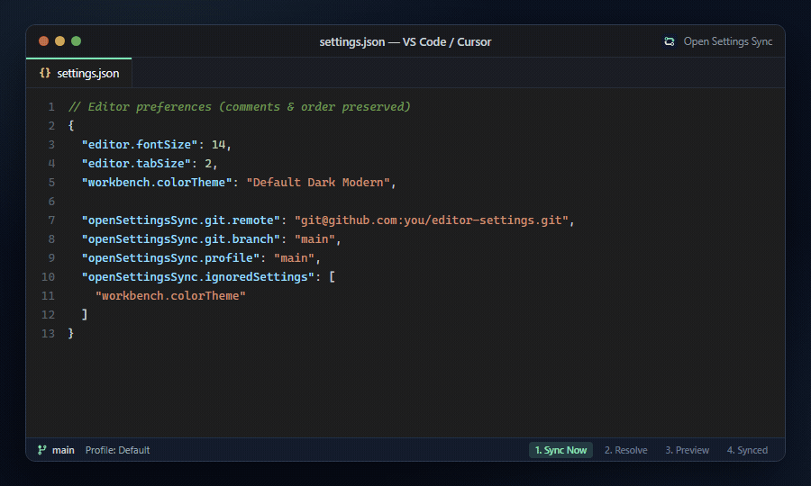

# Open Settings Sync

Sync portable user settings and user-installed extensions across **VS Code** and **Cursor** through your own Git repository — manual-first, reviewable, and safe by default.



## Highlights

- **Cross-editor & clean**: Works identically in VS Code and Cursor desktop profiles without touching editor SQLite databases or credential stores.
- **Three-way settings merge**: Merges independent edits, propagates deletions, prompts on value or key-order conflicts, and previews changes before writing.
- **JSONC-friendly**: Preserves your comments, formatting, trailing commas, key order, and ignored settings.
- **Three-way extension sync** combines both inventories on the first sync. After that, removing a previously synced extension from Git proposes a local uninstall. Uninstalling it locally proposes removing its ID from Git. The review lists removals before you apply them. Built-in and ignored extensions stay local.
- **Safe Git & local backups**: Uses an isolated bare Git cache (hooks disabled, `--force-with-lease`), updates only `.settings-sync/<collection>.json`, and keeps up to 20 local backups per settings file.

## Quick Start

1. **Install** Open Settings Sync from the Visual Studio Marketplace, Open VSX Registry, or a `.vsix` file. Ensure **Git** is installed and authenticated via your SSH agent or credential helper.
2. **Configure** once per editor profile with **Open Settings Sync: Configure** (`openSettingsSync.configure`):
   - **Git repository**: SSH, HTTPS, SSH alias, or absolute local path (embedded credentials are rejected).
   - **Branch**: Target branch (created automatically if missing).
   - **Shared collection**: Logical profile name stored at `.settings-sync/<collection>.json`.
3. **Sync** with **Open Settings Sync: Sync Now** (`openSettingsSync.sync`). Resolve any conflicts if prompted, inspect the **Preview**, and choose **Apply Sync** at the top of the preview tab.

## Configuration

Settings live under `openSettingsSync.*` (`scope: "machine"`):

```jsonc
{
  "openSettingsSync.git.remote": "git@github.com:you/editor-settings.git",
  "openSettingsSync.git.branch": "main",
  "openSettingsSync.profile": "main",
  "openSettingsSync.ignoredSettings": [
    "workbench.colorTheme",
    "myExtension.machine*"
  ],
  "openSettingsSync.ignoredExtensions": ["company.private-extension"]
}
```

- **Wildcards & inheritance**: Ignore lists support case-insensitive `*` wildcards. Default profile ignore lists (and connection settings, until overridden) apply to named profiles automatically.
- **Exclusions & secrets**: Sync settings, machine-scoped settings, and built-in extensions are excluded automatically. Sensitive user settings are **not** guessed — exclude any key or dotted path (e.g. `rest-client.defaultHeaders.X-API-Key`) via `openSettingsSync.ignoredSettings`.
- **Extension packs** are uninstalled only when the review includes every installed member the editor would remove with the pack. If a member needs to stay installed, the sync log identifies it.

## Commands

| Command | Description |
| --- | --- |
| **Open Settings Sync: Configure** | Bind the active editor profile to a Git repo, branch, and collection. |
| **Open Settings Sync: Sync Now** | Three-way sync settings and extensions with conflict prompts and preview. |
| **Open Settings Sync: Restore Settings Backup** | Restore one of the up to 20 local backups for the current settings file. |

> **Diagnostics & retries**: Open **View → Output** and select **Open Settings Sync** for logs (settings values and credentials are never logged). If an extension is unavailable in an editor's marketplace, it is skipped with a warning so the rest of the sync still completes.

## Development

Requires **Node.js 22+** and **Git**.

```sh
npm ci
npm run check
npm run package
```

- Press **F5** in VS Code or Cursor to launch an Extension Development Host (sync never runs automatically on activation).
- Run editor-host smoke tests against a disposable profile with `VSCODE_SYNC_EDITOR="/path/to/editor" npm run test:editor`.

## License

[Apache License 2.0](./LICENSE.md)
